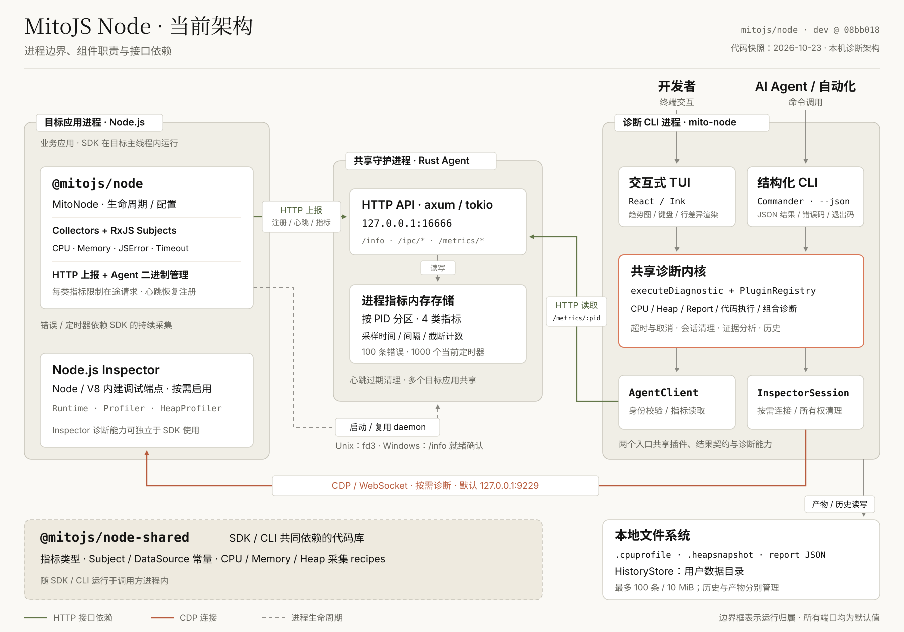

# MitoJS Node 贡献指南

## 环境与源码体验

需要 Node.js `^20.19.0 || >=22.12.0`、pnpm 10.x（仓库固定 `10.33.0`）和 Rust 工具链。Windows 构建还需要 Bash；支持的平台和发布限制见 [README](../README.md) 与[验证说明](../docs/validation.md)。

在仓库根目录运行：

```bash
pnpm install --frozen-lockfile
pnpm build
node scripts/self-test-terminal.mjs
```

`pnpm build` 按 shared → SDK → CLI 构建 TypeScript 产物，再构建当前平台的 Rust Agent。最后一条命令需要真实 TTY，会启动自己的 SDK 示例进程和 TUI，自动选择示例 PID；Ctrl+C 退出并清理示例和连接。更多 demo 见 [demos/](../demos/)。

## 当前架构

下面是组件与部署架构，按进程边界展示模块职责和接口依赖。图中的代码快照和源码链接固定到 `08bb018`。



[架构说明与源码索引](../docs/architecture.html) · [SVG 原图](../docs/assets/architecture/current.svg) · [PNG 图片](../docs/assets/architecture/current.png)

交互式说明页可在下载源码后用浏览器打开 `docs/architecture.html`；点击组件或使用下拉框可查看职责与对应源码，窄屏支持横向滚动。

| 组件 | 代码位置 | 职责与运行归属 |
| --- | --- | --- |
| SDK `@mitojs/node` | [`packages/node/src/`](../packages/node/src/) | 在目标应用主线程运行 Collector / RxJS Subject，管理生命周期、Agent 二进制和 HTTP 上报 |
| CLI `@mitojs/node-cli` | [`packages/node-cli/src/`](../packages/node-cli/src/) | 独立诊断进程；TUI 与结构化 JSON CLI 共用执行器、插件及结果契约 |
| Rust Agent | [`agent/src/`](../agent/src/) | 多个目标应用共享的本机守护进程，提供 HTTP API、按 PID 分区的指标内存存储与心跳过期清理 |
| 共享库 `@mitojs/node-shared` | [`packages/shared/src/`](../packages/shared/src/) | SDK / CLI 的进程内代码依赖，统一指标类型、常量和采集 recipes |

修改代码时需保持以下边界：

- SDK 直接通过 HTTP 向 Agent 上报，默认连接 `127.0.0.1:16666`。Agent 的内存指标与 CLI 保存的文件分别管理。
- TUI 面向人，JSON CLI 面向 AI Agent / 自动化；两者通过 `executeDiagnostic` 和 `PluginRegistry` 复用诊断能力。交互界面按需加载。
- CPU / Memory 优先读取新鲜 Agent 指标，可回退目标进程的 Inspector；CPU Profile、Heap Snapshot、进程报告与代码执行使用 CDP WebSocket。Inspector 默认端口为 `9229`，Windows 需要预先用 `--inspect` 启用。
- 错误和定时器依赖 SDK / Agent，缺少有效数据时返回 `SDK_REQUIRED`。各类指标的新鲜度分别根据原始采样时间判断。
- 诊断产物写入指定目录，普通文件命令未指定目录时使用系统临时目录；历史默认写入用户数据目录，上限 100 条 / 10 MiB，修剪历史不会删除产物文件。

架构变化时同步更新 `docs/assets/architecture/current.svg`、`docs/architecture.html` 内的 SVG 和源码索引，并重新渲染 `current.png`。同时核对代码快照、进程边界、端口与存储归属，在 README 和本指南中保留相同的架构入口。

## 开发与验证

常用命令均在仓库根目录执行：

```bash
pnpm build:ts                                      # shared → SDK → CLI
pnpm build:rust                                    # 当前平台 Rust Agent
pnpm test                                          # 构建/包装工具与各包单测
cargo test --locked --manifest-path agent/Cargo.toml
pnpm test:e2e                                      # 构建并验证真实 CLI/SDK/Agent/PTY
pnpm lint
```

新增功能或修复缺陷遵循 TDD：先运行失败测试，再实现与重构。SDK 逻辑在 `packages/node/src/__test__/` 验证；CLI / TUI 在 `packages/node-cli/src/__test__/` 和对应 E2E 配置中验证；Rust 公开 API 与 HTTP 端点测试遵循 [AGENTS.md](../AGENTS.md) 的位置约定。

修改协议、采集器、生命周期或诊断逻辑时，补充正常与异常路径，并在提交前执行 `pnpm test`、Rust 测试及受影响的 E2E。修改 TUI 时，还需检查方向键、任务取消、进程切换、终端 resize、窄屏布局和退出清理。Inspector 及代码执行验证只针对自己拥有的开发进程。

纯文档或架构图改动需核对文件链接、源码索引、SVG / PNG 内容一致性，检查桌面与窄屏显示；交互说明页还需检查组件选择、缩放、键盘操作和下载入口。

## 提交与文件入库

提交使用 Conventional Commits，scope 取 workspace 包名或 `architecture` / `agent`，格式与检查规则见 `commitlint.config.js`、`biome.json`。提交前检查暂存内容与对应验证结果。

- 保留源码、测试、fixture、demo、构建发布脚本、锁文件、文档和必要平台二进制。
- 精选图片放在 `docs/assets/`；原始日志、回放、覆盖率、诊断产物和本机配置遵循 `.gitignore`，不提交到仓库。
- PR 描述写明问题、最终行为、验证范围和已知边界；架构图需标注源码快照，自测图片需说明采集方式。
- CI 和本地验证分别记录；发布前还需完成 release workflow 的平台二进制与来源校验。
