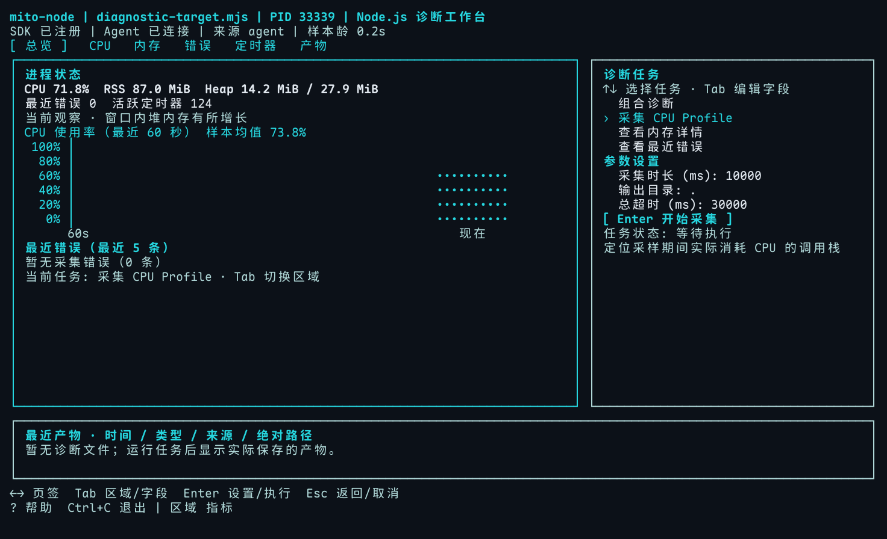
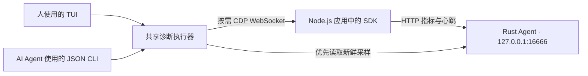

# MitoJS Node

Node.js 性能监控与诊断工具集。SDK 采集 CPU、内存、JS 错误和活跃定时器，Rust Agent 保存采样；人通过交互式 TUI 理解进程状态，AI Agent 通过结构化 JSON CLI 获取证据、执行诊断。

## 特性

- **C 版诊断工作台**：总览、CPU、内存、错误、定时器、产物六个页签；指标与证据、诊断任务与参数、最近产物分区展示。
- **Agent CLI**：一次命令输出一个 JSON 结果，提供错误码、退出码、超时和取消语义。
- **按需诊断**：CPU Profile、Heap Snapshot、进程报告、目标进程代码执行；CPU 与内存优先读取新鲜 Agent 数据，必要时通过 Inspector 获取。
- **组合证据**：实际 CPU 热点、内存和定时器变化；证据不足时明确说明，不根据短时增长确认泄漏。
- **历史与对比**：保存诊断记录、重开结果、比较同进程同命令的两次成功记录、查找产物绝对路径。
- **生命周期管理**：SDK 启动失败可回滚与重试，异步销毁；共享 Agent、心跳恢复与有界指标存储。

## 从源码快速体验

需要 Node.js `^20.19.0 || >=22.12.0`、pnpm 10.x（仓库固定 `10.33.0`）与 Rust 工具链。

```bash
pnpm install --frozen-lockfile
pnpm build
node scripts/self-test-terminal.mjs
```

最后一个命令启动自己的 SDK 示例进程和 TUI，使用临时 Agent / Inspector 端口，并自动进入 `diagnostic-target` 工作台；按 P 可以切换到其他进程。示例会主动产生 CPU、内存分配及定时器负载；Ctrl+C 退出时会停止示例、清理连接并恢复原终端。需要真实 TTY 终端。



画面来自真实 SDK / Agent / CLI 会话的终端输出渲染；另见 [80×24 紧凑模式](docs/assets/tui/workbench-80x24.png)、[组合诊断结果](docs/assets/tui/diagnosis-result.png)和[验证范围与已知限制](docs/validation.md)。

## 包结构

Monorepo 使用 pnpm workspaces 与 Nx 管理：

| 包 | 说明 |
| --- | --- |
| [`@mitojs/node`](packages/node/README.md) | SDK：采集器、共享 Rust Agent 管理、HTTP 上报 |
| [`@mitojs/node-cli`](packages/node-cli/README.md) | `mito-node`：TUI 与结构化 CLI，共用诊断执行器 |
| `@mitojs/node-shared` | SDK / CLI 共用协议、常量与诊断代码片段 |
| `agent/` | Rust Agent：axum / tokio HTTP 服务、注册与指标存储 |

发布版本的安装入口为 `pnpm add @mitojs/node` 与 `pnpm add -D @mitojs/node-cli`。本轮实现尚未发布到 npm，体验当前功能请先使用源码构建流程。

## SDK：接入自己的应用

在业务启动阶段显式启动 SDK，在应用关闭流程中等待销毁：

```ts
import { MitoNode } from '@mitojs/node'

const monitor = new MitoNode({
	metrics: {
		CPU: { interval: 1000 },
		Memory: { interval: 1000 },
		JSError: true,
		Timeout: true,
	},
})

await monitor.start()
// 启动自己的 HTTP 服务或其他业务。

// 在应用现有的关闭流程中执行：
// await monitor.destroy()
```

所有指标默认开启。CPU / Memory 可设置正数 `interval`（毫秒），默认 5000；Timeout 当前为开关，默认每 5000 ms 发送活跃快照；错误事件即时采集。未指定的选项仍使用默认值，禁用时显式设为 `false`。

`start()` 成功表示 Agent 已通过身份校验并注册；采样就绪还需等待对应采集周期。启动失败会 reject，可修复配置后重试。`destroy()` 返回 Promise，注销当前 PID、停止采集并恢复自有钩子，同时保留后来安装的第三方定时器包装。

SDK 默认连接 `127.0.0.1:16666`。自定义端口时，在启动应用前设置 `MITO_AGENT_TCP_PORT`，并给 CLI 配置相同的 `--agent-port`。更多配置、生命周期与单独订阅方式见 [SDK 文档](packages/node/README.md)。

## 人使用：诊断工作台

构建后在终端运行：

```bash
node packages/node-cli/dist/cli.mjs --interactive
# 直接连接自己的目标进程：
node packages/node-cli/dist/cli.mjs --interactive --pid 12345
# 安装已发布 CLI 后使用：mito-node --interactive
```

宽屏推荐 120×36；80×24 使用当前区域的紧凑布局，仍可切换任务、编辑参数和查看长结果。`NO_COLOR=1` 关闭颜色。

| 按键 | 行为 |
| --- | --- |
| `/`、R | 搜索 / 刷新进程列表 |
| ← / → | 切换总览、CPU、内存、错误、定时器、产物页签 |
| Tab / Shift+Tab | 切换区域或参数字段 |
| ↑ / ↓、Enter | 工作台直接选择任务；Enter 进入参数，编辑参数时 ↑ / ↓ 切换字段 |
| Ctrl+U | 清空当前参数字段 |
| Esc | 返回；任务执行中请求取消并等待连接清理 |
| H、X | 历史记录；展开完整命令或结果堆栈 |
| PgUp / PgDn、J / K | 滚动长内容 |
| ?、Ctrl+C | 帮助；清理连接并退出 |

CPU 的 100% 约为一个逻辑 CPU，多核可超过 100%。RSS 是进程驻留内存，Heap 是 V8 JS 堆。缺失与过期采样不当作零值；仅通过 Inspector 连接时会提示错误 / 定时器需要接入 SDK 并连接 Agent。工作台使用独立终端缓冲区，只重绘发生变化的行；诊断文件保存后显示绝对路径与查看方式，部分失败也保留已保存的产物信息。

## Agent 使用：结构化 CLI

以下命令使用安装后的 `mito-node`。从源码使用时，将其替换为 `node packages/node-cli/dist/cli.mjs`，并将 `12345` 换成自己的目标 PID：

```bash
mito-node monitor-cpu --pid 12345 --json
mito-node memory --pid 12345 --json
mito-node diagnose --pid 12345 --duration 6000 --scenario all --dir ./diagnosis --json
mito-node run-code --pid 12345 --code 'process.pid' --json
mito-node history --json
mito-node history --id RECORD_ID --json
mito-node history --compare ID1,ID2 --json
mito-node history --artifacts --json
```

`--json` 使 stdout 只输出一个完整结果，调试信息写入 stderr。`monitor-cpu` / `monitor-memory` 读取一次快照后退出，连续观察使用 TUI。结果保留 `0`、`false`、空字符串和 `null`。退出码：成功 `0`、诊断失败 `1`、参数错误 `2`、取消 `130`；失败时读取 `errorCode`、`error` 和可选的 `suggestion`。

| 命令 | 用途 | 主要参数 |
| --- | --- | --- |
| `cpuprofile` | CPU Profile | `--duration <ms>`，默认 10000 |
| `heapsnapshot` | 堆快照 | `--dir <dir>` |
| `memory` / `monitor-memory` | 内存详情 / 一次内存快照 | — |
| `monitor-cpu` | 一次 CPU 使用率 | — |
| `errors` / `timers` | 最近错误 / 当前活跃定时器与创建位置 | 需要 SDK 对应采集项与 Agent |
| `diagnose` | CPU 热点、内存与定时器变化 | `--duration <ms>` 默认 3000；`--scenario` 取 `cpu`、`memory`、`timers`、`all` 中一个值 |
| `history` | 列表、详情、对比、产物路径 | `--id <id>`、`--compare <id1,id2>`、`--artifacts` 三者互斥；无需 PID |
| `run-code` | 目标进程内执行表达式或代码体 | `--code <code>` 或 `--file <file>`，二选一；代码体用 `return` 返回结果 |
| `start-inspect` / `stop-inspect` | 启用 / 关闭 Inspector | `--port <port>` |
| `report` | Node.js 进程报告 | `--dir <dir>` |

全局参数：`--pid` 指定目标；`--port` 为目标配置的 Inspector 端口，默认 9229；`--agent-port` 为本地 Agent 端口，默认 16666，也读取 `MITO_AGENT_TCP_PORT`；`--timeout` 为诊断总超时，默认 30000 ms；`--dir` 为文件目录；`--history-dir` 为历史目录；`--no-history` 跳过保存本次记录。未指定 `--dir` 时，普通文件命令默认写入系统临时目录；TUI 参数中会显示当前输出目录。

Inspector 按需连接并校验目标 PID；自动诊断结束后关闭本次启用的 Inspector，保留预先存在的调试器。`--port` 不会更改目标的配置；非默认端口可在启动应用时用 `node --inspect-port=9230 app.mjs` 配置，随后给 CLI 传 `--port 9230`。Windows 需要先用 `--inspect` 启用目标调试器。仅对自己拥有的开发 / 调试进程使用代码执行等功能。

内存和定时器变化分析需要两个不同时间的样本，默认采集周期下建议 `--duration 6000` 或更长。错误和定时器没有 Inspector 回退，缺少新鲜 SDK 数据会返回 `SDK_REQUIRED`。历史默认存入用户数据目录，上限 100 条 / 10 MiB；修剪历史不会删除产物文件。比较要求同 PID、同命令的两条成功记录。

## 架构



SDK 的 Collector / Subject 负责采集和分发，直接通过 HTTP 上传，不再经过 Worker 代理。Agent 保存每类指标的时间、间隔与截断数：最多 100 条错误与 1000 个当前定时器。SDK 每 30 秒心跳；自动创建的共享 Agent 在没有注册进程后空闲 30 秒退出，手动启动的 Agent 保持运行。

## 开发与验证

```bash
pnpm build:ts          # shared → SDK → CLI
pnpm build:rust        # 当前平台 Rust Agent
pnpm build            # TypeScript / CLI 与 Rust Agent
pnpm test             # TypeScript 单测与包装工具测试
pnpm test:e2e         # 构建后运行真实 SDK → Agent → CLI 测试
pnpm test:coverage    # 各包 V8 覆盖率
pnpm lint             # Biome
cargo test --locked --manifest-path agent/Cargo.toml
pnpm test:package    # 构建、打包并在干净目录安装与联调
```

当前回归：TypeScript 241 项、Rust 81 项、构建 CLI E2E 18 项通过。覆盖率、性能样本与平台边界见[验证说明](docs/validation.md)。原始日志、覆盖率 HTML、终端回放与诊断文件仅保存在本地 `docs/reports/`，不提交到仓库。

当前本地运行验证覆盖 Darwin ARM64 与 Node 20.19.0 / 22.22.2。其余四个平台随仓库保存的二进制仍为历史产物，公开发布前须由 release workflow 重建五个平台并校验 manifest；本次未执行远端 CI，也未发布 npm。高频定时器场景 CPU 增量中位数仍为 2.11 个单核百分点，未达到 1 个百分点参考目标；不能把性能结果概括为“零阻塞”或固定低于某个开销上限。

## 贡献与许可证

欢迎贡献代码，参见 [CONTRIBUTING.md](.github/CONTRIBUTING.md)。使用 MIT License，参见 [LICENSE](LICENSE)。
